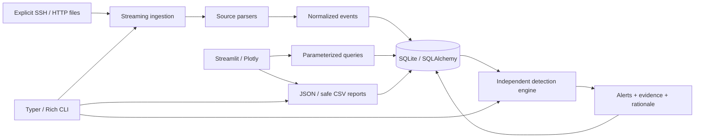

# Security Log Analyzer & Threat Detection

[](https://github.com/gig0d/security-log-analyzer/actions/workflows/ci.yml)

A local Python application that turns SSH authentication and HTTP access logs into
normalized events, explainable alerts, and evidence-linked investigations.
Built by **Giovanny Alvarado Barrantes**.

Authentication failures and probing requests often appear as disconnected records.
This project correlates them, preserves their file/line references, and gives an
analyst a repeatable investigation and reporting workflow. It is a defensive
educational tool, **not a production-certified SIEM**.

## Implemented capabilities

- OpenSSH ISO/syslog and Apache/Nginx Common/Combined log parsing.
- Streaming imports from explicit files or flat local directories, with resource
  limits, malformed-record accounting, provenance, and deterministic deduplication.
- Six configurable rules: SSH brute force, password spraying, SSH success after
  failures, HTTP enumeration, suspicious request indicators, and HTTP authentication abuse.
- SQLite/SQLAlchemy persistence, explicit schema migrations, evidence associations,
  analysis configuration snapshots, and investigation status history.
- A Typer/Rich CLI and five Streamlit sections: Overview, Security alerts,
  Log explorer, Detection rules, and Reports.
- Database-calculated metrics, interactive Plotly charts, bounded tables,
  self-contained JSON incident reports, and spreadsheet-safe CSV summaries.
- A deterministic, separately labeled synthetic demo; Pytest, branch coverage,
  Ruff, strict MyPy, and Windows/Linux GitHub Actions.

## Quick start: Windows PowerShell

Prerequisites: Git and Python **3.13**, or [uv](https://docs.astral.sh/uv/getting-started/installation/).
No administrator privileges, Linux subsystem, paid API, or cloud service is required.
These commands run from the clone without activation or PowerShell policy changes:

```powershell
git clone https://github.com/gig0d/security-log-analyzer.git
cd security-log-analyzer
uv python install 3.13
uv sync --frozen --extra dev --python 3.13
.\.venv\Scripts\security-log-analyzer.exe demo --json
$env:SLA_DATABASE = "data/demo.db"
.\.venv\Scripts\python.exe -m streamlit run dashboard.py
```

Open **http://127.0.0.1:8501**. The server binds to loopback and disables usage
telemetry. Select the database in the sidebar: the default is `data/analyzer.db`,
while the demo deliberately uses `data/demo.db`.

Without uv, use standard Python and the exported hash-locked dependencies:

```powershell
py -3.13 -m venv .venv
.\.venv\Scripts\python.exe -m pip install --require-hashes -r requirements-dev.lock
.\.venv\Scripts\python.exe -m pip install --no-deps --no-build-isolation -e .
.\.venv\Scripts\security-log-analyzer.exe demo --json
```

If the launcher is unavailable, verify `python --version` is 3.13 and use
`python -m venv .venv`. On Linux, use `.venv/bin/python` and
`.venv/bin/security-log-analyzer` after the same uv setup.

## Reproducible demonstration

The fixed dataset contains **53 events** and produces **8 alerts** with defaults:

| Rule | Alerts | Example evidence |
| --- | ---: | --- |
| SSH brute force | 2 | Five failures from `192.0.2.10`; five from the spraying source |
| SSH password spraying | 1 | Five distinct accounts from `192.0.2.20` |
| SSH success after failures | 1 | Three failures and a success for `operator` from `192.0.2.30` |
| HTTP enumeration | 1 | Four sensitive paths from `198.51.100.10` |
| Suspicious HTTP request | 2 | SQL probing and traversal indicators from `198.51.100.20` |
| HTTP authentication abuse | 1 | Five 401 responses at `/login` from `198.51.100.30` |

All IPs use reserved documentation ranges. Inputs and ground truth are separate in
`examples/`; the installed demo regenerates them without a checkout. Fixture-based
precision/recall is reported, with an explicit limitation: these small, constructed
examples do not measure real-world accuracy.

## CLI workflow

```powershell
$sla = ".\.venv\Scripts\security-log-analyzer.exe"
& $sla --help
& $sla ingest examples/auth.log --source ssh --db data/analyzer.db --json
& $sla ingest examples/access.log --source http --db data/analyzer.db --json
& $sla detect --db data/analyzer.db --json
& $sla alerts --db data/analyzer.db --severity HIGH --status NEW --json
& $sla events --db data/analyzer.db --source http --limit 25 --offset 0 --json
$result = & $sla alerts --db data/analyzer.db --json | ConvertFrom-Json
$alertId = $result.alerts[0].id
& $sla show $alertId --db data/analyzer.db --json
& $sla status $alertId INVESTIGATING --db data/analyzer.db --note "Reviewing authentication history"
& $sla report --db data/analyzer.db --alert-id $alertId --filename incident.json
& $sla report --db data/analyzer.db --format csv --filename alerts.csv
```

Directory imports read immediate `.log`/`.txt` files only. They do not recurse,
follow final symlinks/junctions, scan the computer, or automatically collect system
logs. For HTTP logs from known servers, use `--host web-lab` to separate correlation
groups; an omitted host remains null.

`detect`, `alerts`, `events`, and `report` accept inclusive timezone-aware periods:

```powershell
& $sla alerts --since "2026-01-15T12:00:00Z" --until "2026-01-15T12:05:00Z" --ip 192.0.2.10
& $sla alerts --rule SSH_BRUTE_FORCE --search "authentication" --limit 50
& $sla rules --json
```

Exit codes: **0** success; **1** import completed with parse/file failures;
**2** invalid arguments, configuration, missing inputs, or failed operations.
JSON success output goes to stdout; operation errors go to stderr.

## Configuration and log formats

Copy `config.example.toml` to `config.toml`, edit the values, and pass
`--config config.toml` to `ingest`, `detect`, or `rules`. Select that same configuration
file in the dashboard when running detection there.

```text
2026-01-15T12:00:00+00:00 lab sshd[123]: Failed password for alice from 192.0.2.1 port 22 ssh2
Jan 15 12:00:00 lab sshd[123]: Accepted publickey for alice from 192.0.2.1 port 22 ssh2
192.0.2.1 - - [15/Jan/2026:12:00:00 +0000] "GET /products HTTP/1.1" 200 128
```

Yearless SSH records require explicit `ssh_year`; `ssh_timezone` defaults to UTC
and is recorded as an assumption. Ambiguous/nonexistent daylight-saving times need
an offset-bearing timestamp. No year, rollover, IP, or country is inferred.
Unsupported SSH messages are reported as parse failures.

Default limits: **16 KiB per record including newline**, **50 MiB per file**,
**100 MiB selected inputs**, **100 files**, **1,000 directory entries**,
**100,000 records per import**, and **100,000 events per analysis**. Hashing/parsing
uses two streaming passes with a total I/O budget of twice the input-byte limit.
Oversized records are drained in bounded chunks. Compressed logs are unsupported.

## Architecture and stack



Python 3.13; standard-library dataclasses, regex, `ipaddress`, `zoneinfo`, and TOML;
SQLAlchemy/SQLite; Typer/Rich; Streamlit/Plotly; Pytest/pytest-cov; Ruff; MyPy.
Domain validation and two numbered additive migrations keep Pydantic/Alembic
unnecessary for this schema. Application analytics use SQL aggregates; pandas is
a Streamlit transitive dependency. Exact dependencies live in `uv.lock` and
the exported hash-locked `requirements-dev.lock`.

## Testing

```powershell
.\.venv\Scripts\python.exe scripts/check.py
# Or run checks individually:
.\.venv\Scripts\python.exe -m ruff check .
.\.venv\Scripts\python.exe -m ruff format --check .
.\.venv\Scripts\python.exe -m mypy
.\.venv\Scripts\python.exe -m pytest --cov --cov-report=term-missing --cov-report=xml
```

Local Windows validation on Python 3.13.16: **73 passed, 1 skipped; 94% combined
statement/branch coverage**. The symbolic-link test requires Windows developer mode
or suitable rights; Linux CI exercises it. Streamlit AppTest covers navigation,
filtering, empty/error states, and persisted status changes. A clean wheel
installation runs the synthetic demo. See [testing details](docs/testing.md).

## Security and limitations

Logs are untrusted: control characters are escaped, SQL values parameterized,
CSV formulas guarded, and request strings never executed. Actual logs can still
contain secrets/personal information. Keep them in ignored local directories and
restrict filesystem access; SQLite and reports are not encrypted by this tool.

Rules flag suspicious evidence, not confirmed compromise. Shared IPs, legitimate
scanners/retries, clock errors, missing logs, encoding variants, and application
semantics can cause false positives or missed detections. There is no automatic
blocking, scanning, exploit execution, log collection, or external threat intelligence.
Truly identical normalized same-time records collapse by design.

This is a local single-user batch tool. It lacks application authentication,
authorization, multi-tenant isolation, real-time agents, distributed correlation,
high availability, and enterprise retention controls. Do not expose Streamlit
publicly without additional protections. No certification/compliance claim is made.

## Technical documentation

- [Architecture and processing sequence](docs/architecture.md)
- [Detection rules and deterministic semantics](docs/detection-rules.md)
- [Data model and migrations](docs/data-model.md)
- [Testing and evaluation](docs/testing.md)
- [Security boundaries](docs/security.md)
- [Demonstration walkthrough](docs/demo.md)
