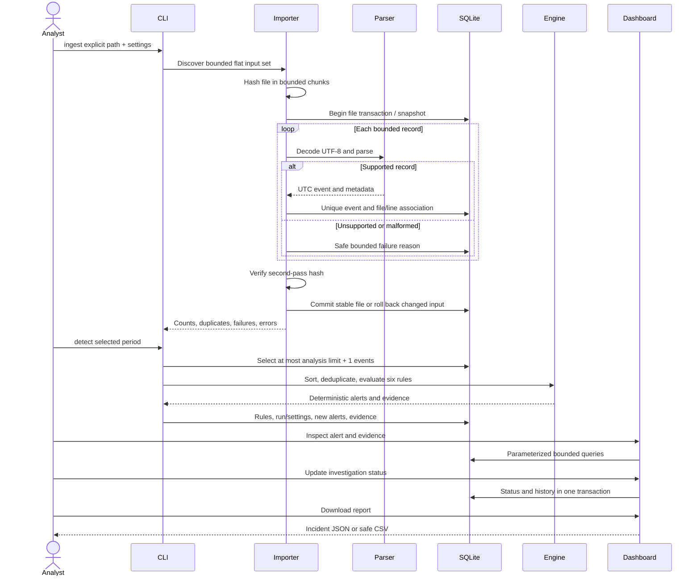

# Architecture

The application is a local batch pipeline with two clients. Typer handles imports,
analysis, investigation, and export. Streamlit provides database-backed monitoring,
investigation, and report downloads. Neither client owns the detection logic.
No process watches files or collects logs in the background.

| Module | Responsibility |
| --- | --- |
| `config.py` | Frozen settings, strict TOML keys, positive limits, timezone validation |
| `models.py` | Normalized records and severity/status enums |
| `parsers.py` | OpenSSH and HTTP recognition and UTC normalization |
| `ingestion.py` | Explicit discovery, bounded reads, hashing, provenance, deduplication |
| `detection.py` | Pure event-to-alert rules and stable identifiers |
| `storage.py` | SQLAlchemy mappings, SQLite foreign keys, numbered migrations |
| `migrations.py` | SSH identity reconstruction and historical alert aliases |
| `repository.py` | Bound filters, pagination, SQL aggregates, analysis/status transactions |
| `reporting.py` | Bounded incident/summary reports and safe CSV |
| `demo.py` | Fixed synthetic scenarios, separate labels, evidence evaluation |
| `cli.py` / `dashboard.py` | Validated inputs and presentation |

The architecture diagram is in the README. The full processing sequence is:

Each stable file commits independently. Malformed lines do not discard valid
neighbors. A changing file, read error, or exhausted execution budget rolls back
the current file and reports the error; earlier files remain committed. Summaries
count committed file results. An interrupted process may leave a RUNNING audit
row; reimporting safely deduplicates already committed events.

Two streaming passes hash and parse each file. Actual total read traffic is bounded
to twice `max_total_bytes`, with a shared execution record budget. Directory entry
enumeration is separately bounded. Hashes detect observed content changes; they
are not forensic signatures or protection against a hostile same-user filesystem race.

Analysis refuses oversized scopes rather than silently truncating them. Narrow
the period when necessary. Queries return at most 500 rows; dashboard pages use 50.
Reports cap alerts/evidence at 10,000. SQL aggregates can still scan significant
local data; there is no distributed analytics or throughput guarantee.

Three explicit schema migrations handle the small schema and SSH identity upgrade.
Migration writes and version changes share an explicit SQLite transaction. Stored
source records reconstruct legacy connections; old alert references resolve through
aliases while investigation history is retained. Introduce richer migration tooling
if later versions require more complex transformations.
All import/detection/report workflows work without Streamlit.
