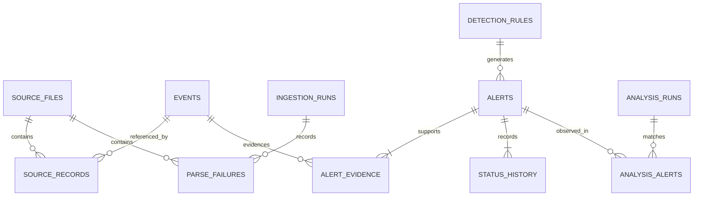

# Data model and migrations

SQLite is local, unencrypted storage. SQLAlchemy parameterizes values, enables
foreign keys per connection, and uses a five-second busy timeout. Event, source,
and alert identifiers are SHA-256 hex strings.

| Table | Purpose |
| --- | --- |
| `source_files` | Snapshot ID, canonical path, byte hash/size, import time |
| `ingestion_runs` | Execution start/end, RUNNING/COMPLETED/PARTIAL state, summary |
| `events` | Unique normalized ID, UTC time, source/IP/username, JSON payload |
| `source_records` | Composite snapshot/line key, event FK, sanitized raw record |
| `parse_failures` | Run/source FKs, line number, safe bounded failure reason |
| `detection_rules` | Rule ID and current definition JSON |
| `analysis_runs` | Detection time, complete settings, scope, analyzed/matched/new counts |
| `alerts` | Rule FK, severity, explanation, time span, IP/count/rationale, status |
| `alert_evidence` | Composite alert/event FKs |
| `status_history` | Previous/new status, change time, bounded note |
| `analysis_alerts` | Composite run/alert FKs, including repeated existing matches |

Events include UTC timestamp, source type, nullable host/IP/username, category,
action/outcome, nullable HTTP attributes, and safe parser metadata. Source references
are separate relationships. HTTP outcome is a protocol status classification
(`>=400` failure), not proof of an application's authentication outcome.
OpenSSH supplies a host; HTTP hosts require an optional explicit label.

Invalid IPs become null with bounded validation metadata and are excluded from
IP rules. Invalid/missing timestamps reject a record. Year/timezone assumptions
for syslog are recorded. Event IDs hash the complete normalized payload including
parser metadata, excluding import time and source path/line. Copies share one event
and retain multiple provenance references. Truly separate identical same-time
records collapse. Different parser assumptions can produce different events.

Source snapshot IDs include canonical path, content hash, parser selection, HTTP
host, and SSH year/timezone. Indexes cover event time/source/IP and IP-time,
alert rule/severity/status/time/IP, evidence, and provenance. Checks constrain alert
severity/status, positive count, and ordered times. Composite keys prevent duplicate
associations. Status/history changes commit together; a repeated same-status request
adds no redundant history. Filters use inclusive UTC times and bounded pagination.

## Migrations

`storage.migrate` uses `PRAGMA user_version` and version-controlled ORM table definitions:

| Version | Additive change |
| --- | --- |
| 0 → 1 | Source, ingestion, event, provenance, parse-failure tables |
| 1 → 2 | Rules, analyses, alerts, evidence, history, run matches |

Opening v2 is idempotent. Integration tests retain v1 events through upgrade and
then run detection. Future versions are refused. An existing version-zero database
containing user tables is refused to protect unrelated data. No dashboard feature
accepts arbitrary SQL. Back up a closed database before upgrading.

Downgrades, automated retention, encryption, and distributed schema management
are not implemented. Alembic is unnecessary for these two additive migrations;
adopt richer migration tooling for future column/data transformations.
